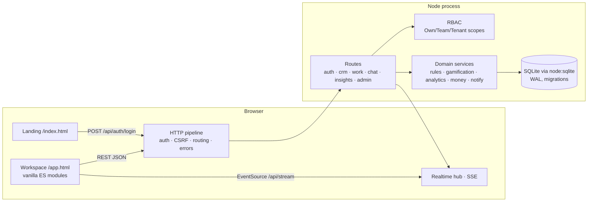

# Architecture overview

## Modules
| Path | Responsibility |
|---|---|
| `server/http.js` | Router, JSON bodies, cookies, error contract `{error:{code,message,details,traceId}}`, static files with CSP |
| `server/auth.js` | scrypt hashing, hashed session tokens, login throttle |
| `server/rbac.js` | Permission matrix and scope filters (single source for UI and docs) |
| `server/services/rules.js` | Pure state machines, round-robin, matching, overlap (unit-tested) |
| `server/services/gamification.js` | Idempotent points ledger, daily cap, achievements |
| `server/services/analytics.js` | Dubai-local periods, KPIs, series, leaderboard, time use |
| `server/routes/*.js` | HTTP endpoints; every query tenant-scoped |
| `server/seed.js` | Deterministic synthetic demo data |
| `public/js/*` | SPA shell, i18n, charts, views |

## Data model (tables)
tenants · teams · users · sessions · contacts · leads · lead_status_history · lead_assignments · properties · deals · deal_stage_history · tasks · events · event_attendees · activities · channels · channel_members · messages · notifications · points_ledger · user_achievements · goals · announcements · audit_log. Full DDL: `server/migrations/001_init.up.sql`.

Conventions: UUIDv7 ids · UTC ISO timestamps · integer minor units + ISO 4217 · basis points for rates · phone/email never unique.

## Security
HttpOnly SameSite=Lax session cookie · custom-header CSRF guard · strict CSP (no inline script or style) · server-side authorization on every endpoint · 404 for out-of-scope records · audit log for sign-ins, assignments, state transitions and admin changes · path-traversal-safe static serving.

## Moving to production (not done)
Postgres with RLS · managed identity with MFA · HTTPS reverse proxy (sets `NODE_ENV=production` for Secure cookies) · backups with a tested restore · structured logs and error tracking · a pub/sub fan-out for SSE across instances.
